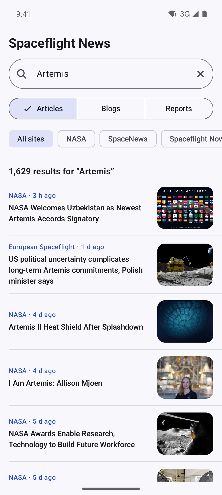
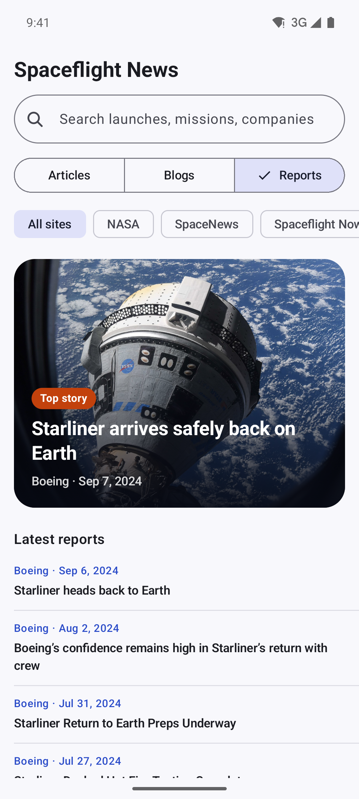
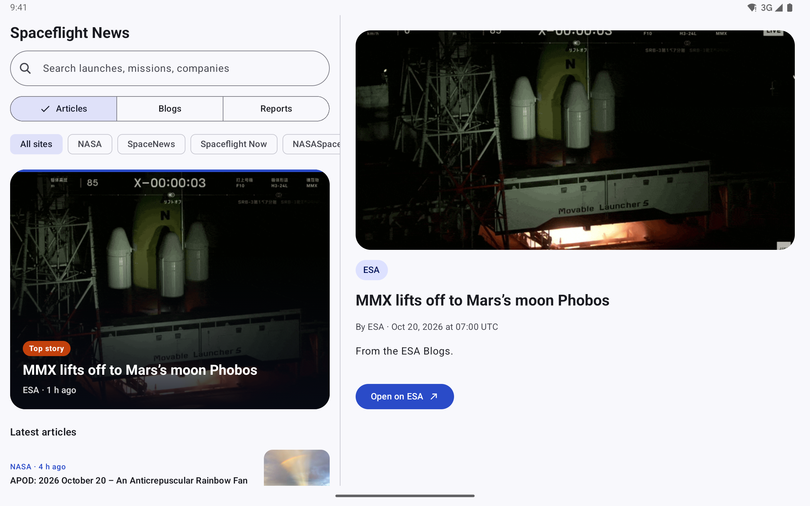

<p align="center">
  
</p>

<p align="center">
  <a href="https://github.com/halilozel1903/spaceflight-news-kotlin/actions/workflows/ci.yml"></a>
  <a href="https://jitpack.io/#halilozel1903/spaceflight-news-kotlin"></a>
  
  
  
  
  
  <a href="LICENSE"></a>
</p>

**spaceflight-news-kotlin** is a Kotlin client for the [Spaceflight News API](https://spaceflightnewsapi.net) (v4) by [The Space Devs](https://thespacedevs.com). It covers articles, blogs and reports from dozens of spaceflight news sites, with typed models for authors, the launches and events each story is linked to, every filter of the API as a typed query, and paging that follows the API's own `next` urls. The client is pure Kotlin/JVM (Ktor, kotlinx.serialization, coroutines), so it runs on Android, on the server and in tests. The sample app is a Compose news reader for phones and tablets.

```kotlin
val client = SpaceflightNewsClient()

val latest = client.articles { limit = 20 }
latest.count                                     // every article in the API
latest.results.first().title                     // the newest headline
latest.results.first().launches                  // [LaunchRef(launchId = "<Launch Library 2 UUID>", provider = "Launch Library 2")]

val artemis = client.articles {
    search = "Artemis"
    newsSites("NASA", "SpaceNews")
    publishedAfter = Instant.parse("2026-01-01T00:00:00Z")
}

client.reports { limit = 5 }.results.map { it.title }
client.info().newsSites                          // ["ABC News", "AmericaSpace", "Arstechnica", ...]
```

## Screenshots

Captured live from the Spaceflight News API by CI, with the sample app on Android emulators. Headlines, sites, dates, summaries and images are real data loaded from api.spaceflightnewsapi.net and the news sites during the run, so they change every time CI runs.

| Feed with the top story | Search | Reports |
| :---: | :---: | :---: |
|  |  |  |

**Tablet:** list and detail side by side, with the article's image, summary, byline, date, linked launches and events, and an "Open on &lt;site&gt;" button.



## Features

- **Articles, blogs and reports**: list and get by id, with `NewsEndpoint.Articles`, `Blogs` and `Reports` for generic code.
- **Typed models**: `Article` (blogs share it), `Report`, `Author` with `Socials`, `LaunchRef` and `EventRef` (Launch Library 2 ids), `Page<T>` and `Info`. Unknown fields are ignored and nulls fall back to defaults, so API additions do not break you.
- **Every filter as a typed query**: search, title and summary text, news sites (include or exclude), published and updated date ranges as `Instant`s, has launch, has event, launch and event ids, featured, ordering, limit and offset. Filters that reports do not support are rejected before a request is sent.
- **Paging that follows `next`**: `nextPage()` and `previousPage()` use the urls the API returns; `pages()` and `all()` are lazy `Flow`s that stop when you stop collecting.
- **News sites**: `info()` returns the API version and the sites it collects from.
- **Helpers**: `publishedInstant`, `updatedInstant`, `byline` ("A, B and C") and `hasImage` on every item.
- **Coroutines**: main-safe `suspend` functions that throw a `SpaceflightNewsException` (`NotFound`, `Http` with status and body, `Network`, `Decoding`).
- **Pluggable HTTP**: Ktor with CIO by default; pass OkHttp, Android, Java or a `MockEngine`, a ready `HttpClient`, or your own `SpaceflightNewsTransport`. Retries with backoff on network errors, 429 and 5xx.
- **Explicit API**, unit tested against JSON fixtures in the API's v4 shape.

### API coverage

| Endpoint | Function | Returns |
| --- | --- | --- |
| `GET /articles/` | `articles(query)`, `articles { ... }` | `Page<Article>` |
| `GET /articles/{id}/` | `article(id)` | `Article` |
| `GET /blogs/` | `blogs(query)`, `blogs { ... }` | `Page<Blog>` (`Blog` = `Article`) |
| `GET /blogs/{id}/` | `blog(id)` | `Blog` |
| `GET /reports/` | `reports(query)`, `reports { ... }` | `Page<Report>` |
| `GET /reports/{id}/` | `report(id)` | `Report` |
| `GET /info/` | `info()`, `newsSites()` | `Info`, `List<String>` |
| Any list | `list(endpoint, query)`, `item(endpoint, id)` | `Page<T>`, `T` |
| `next` / `previous` urls | `nextPage(endpoint, page)`, `previousPage(endpoint, page)` | `Page<T>?` |
| Every page or item | `pages(endpoint, query)`, `all(endpoint, query)` | `Flow<Page<T>>`, `Flow<T>` |

### Query parameters

| `NewsQuery` property | Parameter | Articles, blogs | Reports |
| --- | --- | :---: | :---: |
| `search` | `search` | yes | yes |
| `titleContains` | `title_contains` | yes | yes |
| `summaryContains` | `summary_contains` | yes | yes |
| `newsSites` / `newsSites("A", "B")` | `news_site` | yes | yes |
| `excludedNewsSites` | `news_site_exclude` | yes | yes |
| `publishedAfter` / `publishedBefore` | `published_at_gte` / `published_at_lte` | yes | yes |
| `updatedAfter` / `updatedBefore` | `updated_at_gte` / `updated_at_lte` | yes | yes |
| `hasLaunch` | `has_launch` | yes | no |
| `hasEvent` | `has_event` | yes | no |
| `launchIds` | `launch` | yes | no |
| `eventIds` | `event` | yes | no |
| `isFeatured` | `is_featured` | yes | no |
| `ordering` / `orderBy(...)` | `ordering` | yes | yes |
| `limit` / `offset` | `limit` / `offset` | yes | yes |

## Installation

Add JitPack to `settings.gradle.kts`:

```kotlin
dependencyResolutionManagement {
    repositories {
        google()
        mavenCentral()
        maven("https://jitpack.io")
    }
}
```

Then the dependency:

```kotlin
dependencies {
    implementation("com.github.halilozel1903.spaceflight-news-kotlin:spaceflight-news:1.0.0")

    // Optional: use OkHttp instead of Ktor's CIO engine.
    implementation("io.ktor:ktor-client-okhttp:3.6.0")
}
```

> The build is also set up for Maven Central (`io.github.halilozel1903:spaceflight-news`) via the vanniktech publish plugin.

`spaceflight-news` is a plain Kotlin/JVM library (JDK 17+). On Android, `publishedInstant` and `updatedInstant` use `java.time`, which needs API 26 or core library desugaring; everything else works on any API level.

## Usage

**Create a client**

```kotlin
val client = SpaceflightNewsClient {
    engine = OkHttp.create()                     // default: CIO
    userAgent = "my-reader/1.0 (+https://example.com)"
    requestTimeoutMillis = 15_000
    retries = 2                                  // network errors, 429 and 5xx, with backoff
}
// ...
client.close()
```

Create one client and share it; it is safe to use from many coroutines.

**Filter and sort**

```kotlin
val page = client.articles {
    search = "Starship"
    newsSites("SpaceNews", "NASASpaceflight")
    excludedNewsSites = listOf("Teslarati")
    publishedAfter = Instant.parse("2026-09-01T00:00:00Z")
    publishedBefore = Instant.parse("2026-09-30T23:59:59Z")
    orderBy(Ordering.PublishedAtAscending)
    limit = 50
}

// Stories about a launch or an event from Launch Library 2:
client.articles { launchIds = listOf("0a5d89b0-aa14-4140-b72d-fbcc8340b222") }
client.articles { eventIds = listOf(1493) }
client.blogs { hasLaunch = true }

// A reusable query:
val nasa = newsQuery { newsSites("NASA"); limit = 10 }
client.articles(nasa)
client.blogs(nasa.copy(search = "spacewalk"))
```

**Items**

```kotlin
val article = client.article(38745)
article.title                                    // "NASA awards nearly $600 million in lunar lander missions"
article.newsSite                                 // "SpaceNews"
article.byline                                   // "Jeff Foust"
article.authors.first().socials?.links           // {x=..., linkedin=..., mastodon=..., bluesky=...}
article.events.map { it.eventId }                // [1493]
article.publishedInstant                         // 2026-06-30T23:57:29Z
article.url                                      // the story on spacenews.com
```

**Paging**

The API pages with `limit` and `offset` and returns the url of the next page. The client follows those urls as they are, so every page keeps your filters.

```kotlin
val first = client.reports { search = "Starliner"; limit = 20 }
val second = client.nextPage(NewsEndpoint.Reports, first)        // null on the last page

client.pages(NewsEndpoint.Articles, newsQuery { limit = 100 }).take(3).collect { page -> println(page.results.size) }
client.all(NewsEndpoint.Blogs, newsQuery { newsSites("NASA") }).take(25).toList()
```

**News sites**

```kotlin
val info = client.info()
info.version                                     // "4.33.0"
info.newsSites                                   // ["ABC News", "AmericaSpace", ..., "Virgin Galactic"]
```

**Errors**

```kotlin
try {
    client.article(123_456_789)
} catch (e: SpaceflightNewsException.NotFound) {
    // no such article
} catch (e: SpaceflightNewsException.Http) {
    // e.status, e.body: 400 for an invalid filter value, 429, 5xx
} catch (e: SpaceflightNewsException.Network) {
    // offline or timed out
}
```

**Testing your code**

Pass a Ktor `MockEngine` as `engine`, as this library's own tests do, or replace HTTP entirely:

```kotlin
val client = SpaceflightNewsClient {
    transport = SpaceflightNewsTransport { url -> fixtures.getValue(url) }
}
```

## Sample app

The `sample` module is a news reader. Phones get a feed with the newest story as a hero, a search field, an Articles / Blogs / Reports switch and chips for the news sites from `/info`; the list loads more pages as you scroll, and a story opens a detail screen. Tablets show the list and the detail side by side, with the story's image, summary, byline, date, linked launches and events, and an "Open on &lt;site&gt;" button that opens the full story in the browser. It uses the live API, OkHttp as the Ktor engine and Coil for the images.

For screenshots it opens a fixed screen from an intent extra (used by `scripts/screenshots.sh`):

```bash
./gradlew :sample:installDebug
adb shell am start -n io.github.halilozel1903.spaceflightnews.sample/.MainActivity --es scene search
```

`scene` is one of `feed` (the newest articles), `search` (articles matching "Artemis"), `reports` (the newest reports) or `tablet` (list and the newest article side by side). Scenes load live data through the same client as a normal launch, and log `SCENE_READY` once the data and every image on screen have loaded. CI captures the phone scenes on a Pixel 7 and `tablet` on a Pixel Tablet in landscape, and fails instead of capturing when a scene shows an error, does not finish loading, misses the expected text or is blank. There is no offline or demo data in the sample.

## Project structure

| Module | What it is |
| --- | --- |
| `spaceflight-news` | Pure Kotlin/JVM: `SpaceflightNewsClient`, `NewsQuery`, models, paging. Published as `spaceflight-news` |
| `sample` | The Compose news reader for phones and tablets, with screenshot scenes |

## Tech stack

Kotlin 2.4 · Ktor 3.6 (CIO, OkHttp) · kotlinx.serialization · kotlinx.coroutines · AGP 9.4 with built-in Kotlin · Gradle 9.6 · Jetpack Compose (BOM 2026.09) · Material 3 · Coil 3 (sample) · GitHub Actions with Android emulators

## Data source

All data comes from the [Spaceflight News API](https://spaceflightnewsapi.net) by [The Space Devs](https://thespacedevs.com), a free API that collects spaceflight news from many sites. Launch and event ids refer to The Space Devs' [Launch Library 2](https://thespacedevs.com/llapi). The articles, summaries and images belong to their publishers; the reader links to the original story on each news site. This project is not affiliated with The Space Devs or any news site. Please keep your request rate reasonable.

## License

MIT. See [LICENSE](LICENSE).
